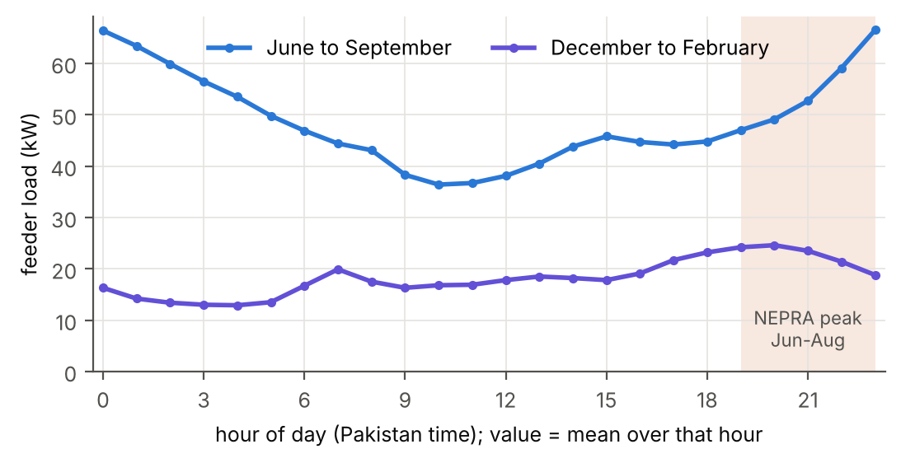
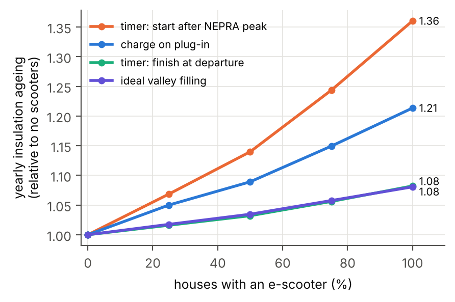

# Midnight, not midday: AC, e-scooter charging and transformer ageing in Lahore

**The question.** Pakistan wants about two million electric two-wheelers on the
road by 2030, and most will be charged at home, on neighbourhood
transformers that already carry heavy air-conditioning load in summer. When is
such a transformer most loaded, and does the time of scooter charging matter
for how fast it ages?

**What is done here.** One year of measured one-minute data from 41 houses in
Lahore (PRECON, LUMS) is joined with NASA POWER weather. Each house's
sensitivity to heat is measured and tested on unseen weeks. 34 houses with
good coverage are summed into a virtual feeder, scooter charging is added
under five rules (energy from the scooter model of
[e2w-controller-wearout](https://github.com/tehreem-gillani/e2w-controller-wearout)),
and the transformer's hot-spot temperature and insulation ageing are computed
with the IEC 60076-7 thermal model.

**Report (IEEE format):** [`report/Gillani_Lahore_Heat_Feeder.pdf`](report/Gillani_Lahore_Heat_Feeder.pdf)



## Main results

- **Heat.** Every house uses more power on hotter days: median 77 W per kelvin
  of daily mean temperature above about 22.5 °C (41 houses; test R² 0.68 on
  unseen weeks). The 34-house feeder: 2.8 kW/K above 23 °C (test R² 0.84).
- **The peak is at night.** From April to September the feeder's highest mean
  load is at 23:00 or midnight, and its lowest between 09:00 and 12:00. The highest
  one-minute load of the year was at 23:50 on 4 June 2018. The summer tariff
  peak window (19:00 to 23:00) ends just as the feeder's own peak starts.
- **Charging time matters more than charging energy.** A scooter in every
  house adds 4 % energy. Yearly transformer ageing rises by:

  | charging rule | 100 kVA | 75 kVA |
  |---|---|---|
  | charge on arrival | +21 % | +50 % |
  | arrival + random delay up to 600 s (UK default) | +21 % | n/a |
  | timer that starts after the tariff peak | **+36 %** | **+110 %** |
  | timer that finishes at departure | +8 % | +11 % |
  | ideal valley filling (perfect foresight) | +8 % | +11 % |

  The "after peak" timer is the worst because it moves every scooter onto the
  night peak at once. Finishing just before departure gives the same
  yearly ageing as the ideal schedule.
- **Climate matters more.** 2 K warmer (through the measured slope) raises
  baseline ageing 2.4 times, more than any charging rule. This is an
  extrapolation and is given as an order of magnitude.



## Code

| File | What it does |
|---|---|
| `src/precon.py` | reads PRECON house files, marks gap-filled stretches, writes the hourly table |
| `src/weather.py` | NASA POWER loader (LST is clock time in Lahore) |
| `src/tempsens.py` | change-point fits of load against temperature, train/test by week |
| `src/feeder.py` | sums houses into the virtual feeder, imputes filled minutes, coverage rule |
| `src/scooter.py` | scooter energy (from Project 2), use profiles, the five charging rules |
| `src/transformer.py` | IEC 60076-7 Annex C thermal model and ageing rate |
| `src/run_all.py` | all scenarios; writes `results/results.json` and `results/summary.txt` |
| `src/figures.py` | figures |
| `tests/` | rated steady state, filter = loop, oil time constant, gap detection, charging energy and windows |

```bash
pip install -r requirements.txt
# download PRECON (see below) and put all HouseN.csv files in one folder
cd src
python precon.py  /path/to/precon_csvs
python feeder.py  /path/to/precon_csvs
python tempsens.py
python run_all.py          # about 1 minute
python figures.py
python ../tests/test_models.py
```

`results/summary.txt` has every number quoted in the report.

## Data

- **PRECON** (Nadeem and Arshad, e-Energy 2019), 1-minute data, June 2018 to
  May 2019, listed on [Open Data Pakistan](https://opendata.com.pk/dataset/precon-pakistan-residential-electricity-consumption-dataset).
  I could not confirm the dataset's licence, so check it before reusing the derived files.
  The raw files are not copied here. House 35 was not in the downloaded
  archive. `data/raw/precon_metadata.csv` is the dataset's metadata file.
- **Derived data (open):** `data/derived/temp_sensitivity_total.csv` and
  `temp_sensitivity_ac_circuits.csv` (per-house balance temperature, slope,
  test R²), `hourly.csv.gz` (hourly load, AC and UPS per house, gap-filled
  hours removed), `feeder_1min.csv.gz`, `feeder_days.csv`,
  `house_summary.csv`, `feeder_houses.csv`.
- **NASA POWER** hourly T2M and ALLSKY_SFC_SW_DWN for 31.52 N, 74.36 E:
  `data/raw/nasa_power_lahore_2018_2019_LST.csv`. Each hourly value
  is taken as the mean of the hour after its time stamp and placed at mid-hour.
- **IEC 60076-7:2005** values were read from IS 2026 (Part 7):2009, which
  states it is identical and is freely available from Public.Resource.Org.

## Related work

The report reviews studies of EV charging and transformer ageing (Gong 2012,
Hilshey 2013, Clement-Nyns 2010, Soleimani 2020, Geiles 2013, Behi 2017), the
timing of home charging (Muratori 2018, Powell 2022, Li and Jenn 2024),
temperature and demand (Auffhammer 2017, Kissock 2003), PRECON (Nadeem and
Arshad 2019, 2020; Bajwa 2026) and electric two-wheelers (Abdul-Manan 2022,
Corti 2024, Huu and Ngoc 2021), and states the gap this work addresses.

## Limitations

- The 34 houses are spread across Lahore and are not one feeder; they are
  mostly large houses with several AC units. Houses per transformer, power
  factor (0.95), charger power and use profiles are assumptions and are
  varied.
- PRECON contains gap-filled minutes whose filling method is not documented;
  they are removed from fits and imputed in the feeder, so load shedding is
  not modelled.
- Air temperature is used as the transformer ambient. The temperature slope
  comes from one year of data. Train and test weeks alternate, so the test
  R² is optimistic for another year.
- The time-of-use peak windows are from NEPRA's LESCO tariff determination of
  7 January 2026 (schedule of tariff, clause 10), not from 2018-19.
  Residential time-of-use applies to connections with a peak load above 5 kW.
- A related study (Bajwa et al., Energy Conversion and Management: X, 2026)
  used PRECON to report the monthly AC share of household use; it does not
  model load against temperature, time of day or the network.

## About

Syeda Tehreem Gillani, FAST-NUCES Karachi. Third part of a series: home
energy ([pv-battery-ems-karachi](https://github.com/tehreem-gillani/pv-battery-ems-karachi)),
vehicle ([e2w-controller-wearout](https://github.com/tehreem-gillani/e2w-controller-wearout)),
neighbourhood (this repo). AI-based coding assistance was used for parts of
the software and the first draft of the text; modelling choices, results and
text were checked by me. License: MIT (code). The derived PRECON files are shared
for reproducibility; the original dataset's terms apply to them.
